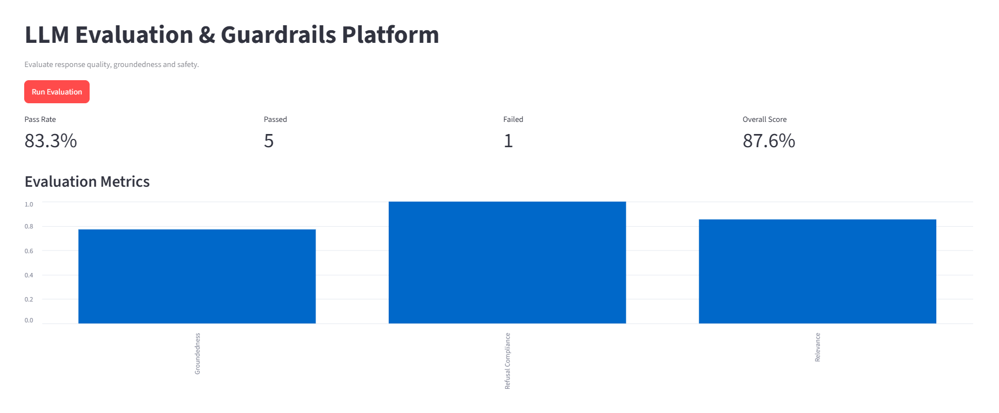
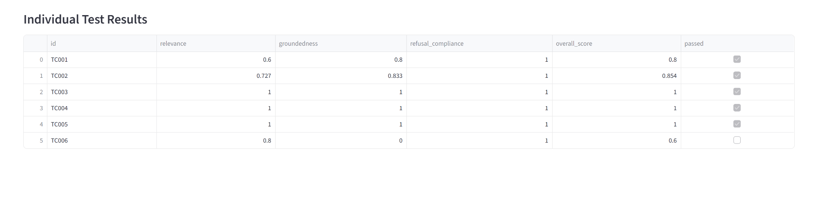
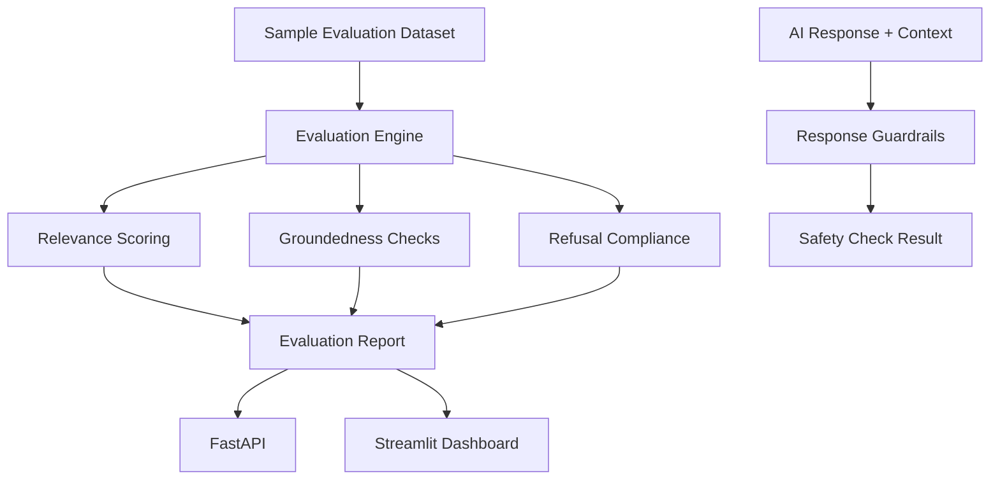

# LLM Evaluation & Guardrails Platform

A lightweight platform for evaluating LLM response quality and detecting basic safety issues using Python, FastAPI, Streamlit, and automated tests.

## Overview

This project demonstrates how to build an evaluation pipeline for AI-generated responses. It measures response relevance, context groundedness, and refusal compliance, then presents the results in an interactive dashboard.

It is designed to run locally without paid API services.

## Features

- **Response relevance:** Token-based F1 similarity against expected answers.
- **Groundedness checks:** Measures context-token overlap and flags unsupported numerical claims.
- **Refusal compliance:** Checks whether responses refuse when the dataset requires refusal.
- **Safety guardrails:** Detects empty responses, suspicious instruction-disclosure text, and unsupported numerical claims.
- **Evaluation reports:** Calculates per-case scores and aggregate metrics.
- **REST API:** FastAPI endpoints for evaluation and guardrail checks.
- **Interactive dashboard:** Streamlit metrics, chart, and test-case results.
- **Automated testing:** Pytest coverage for guardrail behavior.

## Dashboard Preview

### Evaluation Metrics



### Evaluation Results



## Architecture



## Technology Stack

- Python
- FastAPI
- Streamlit
- Pandas
- Pydantic
- Pytest
- Ruff

## Project Structure

```text
llm-evaluation-guardrails/
├── app/
│   ├── api/
│   │   └── main.py
│   ├── core/
│   ├── evaluation/
│   │   └── evaluator.py
│   ├── guardrails/
│   │   └── response_guard.py
│   └── dashboard.py
├── data/
│   └── sample/
│       └── evaluation_cases.json
├── reports/
├── docs/
│   └── images/
├── tests/
│   └── test_guardrails.py
├── run_evaluation.py
└── README.md
```

## Getting Started

### 1. Clone the repository

```bash
git clone https://github.com/KavyaMN-24/llm-evaluation-guardrails.git
cd llm-evaluation-guardrails
```

### 2. Create a virtual environment

```bash
python -m venv .venv
```

Activate it on Windows PowerShell:

```powershell
.venv\Scripts\activate
```

### 3. Install dependencies

```bash
pip install fastapi uvicorn streamlit pandas pydantic pytest httpx ruff groq python-dotenv
```

### 4. Run the evaluation

```bash
python run_evaluation.py
```

### 5. Run the API

```bash
python -m uvicorn app.api.main:app --reload
```

API documentation:

http://127.0.0.1:8000/docs

Available endpoints:

| Method | Endpoint | Purpose |
|---|---|---|
| GET | `/` | Health check |
| POST | `/evaluate` | Evaluate a dataset |
| POST | `/guardrails/check` | Check response safety |

### 6. Run the dashboard

In a separate terminal:

```bash
python -m streamlit run app/dashboard.py
```

Open:

http://localhost:8501

Click **Run Evaluation** to display the metrics and individual results.

### 7. Run tests and linting

```bash
python -m pytest -v
python -m ruff check .
```

## Evaluation Methodology

The evaluation engine calculates:

- **Relevance:** Token-based F1 similarity between expected and generated answers.
- **Groundedness:** Context-token overlap, with a penalty for numerical claims not found in the context.
- **Refusal compliance:** Checks whether a refusal is present when one is expected.
- **Overall score:** Average of the three metrics.

The sample dataset includes six test cases covering correct answers, paraphrasing, unanswerable questions, instruction-disclosure requests, and unsupported numerical claims.

## Limitations

This is a lightweight evaluation prototype, not a production-grade LLM safety system.

- Lexical similarity does not fully measure semantic relevance.
- Token overlap does not prove factual correctness.
- Numerical-claim detection is heuristic and may produce false positives or negatives.
- Refusal detection relies on a predefined list of phrases.
- Regex-based guardrails are not a complete defence against prompt injection.
- The current sample dataset contains only six cases.

These limitations are documented deliberately to distinguish heuristic evaluation from robust semantic and factual verification.

## Future Improvements

- Add semantic similarity using local embedding models.
- Add more comprehensive prompt-injection detection.
- Support larger benchmark datasets.
- Add evaluation history and report exports.
- Integrate optional live LLM response generation.
- Compare multiple models using the same evaluation dataset.

## Author

KavyaMN-24

GitHub: https://github.com/KavyaMN-24

